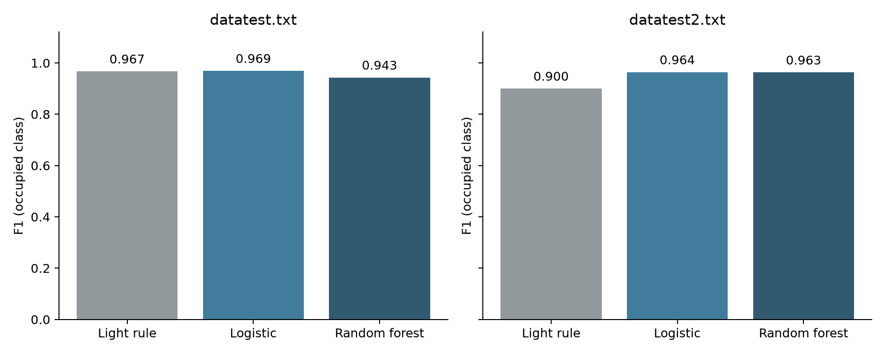

# 基于环境传感器的室内占用检测

大数据分析课程项目。根据温度、湿度、光照、CO₂及含湿量，判断房间当前是否有人，比较阈值规则、逻辑回归与随机森林。

## 当前进度

- [x] 原始数据读取与质量检查。
- [x] 训练文件按时间划分训练集与验证集，并保存划分清单。
- [x] 光照阈值、逻辑回归、随机森林的首轮比较。
- [x] 保存验证配置、两个测试集及合并评价、逐条预测和比较图。
- [ ] 光照、CO₂、组合与全部特征的对比实验。
- [ ] 连续时段图、误报漏报及环境变化滞后分析。
- [ ] 生成课程要求的 `occupancy_predictions.csv`。
- [ ] 完成最终报告与提交核对。

## 数据与实验约定

`data/datatraining.txt` 有8,143条观测；按时间排序，前6,514条训练，后1,629条验证。两个官方测试文件分别有2,665条和9,752条观测，独立评价。

原始文件的表头有7列，数据行额外包含一个记录编号。代码单独保留该编号，`source_row` 使用文件内从1开始的数据行号，不含表头。日期与编号不作为模型输入。`Occupancy=1` 为正类。

候选光照阈值来自训练部分，通过验证集F1选取。逻辑回归和随机森林也只通过验证集选择参数；概率分类阈值固定为0.5。配置确定后，机器学习模型使用完整训练文件重训，标准化也重新在完整训练文件拟合。测试结果用于评价，不用于回头选择参数。汇总指标通过合并预测重新计算。

## 运行

本次实验使用 Python 3.14.9。建议使用独立虚拟环境，依赖版本见 `requirements.txt`。

```powershell
python -m venv .venv
.\.venv\Scripts\python.exe -m pip install -r requirements.txt
.\.venv\Scripts\python.exe step01_check_data.py
.\.venv\Scripts\python.exe step02_compare_models.py
```

若默认 `python` 不可用，请使用正常安装的 Python 可执行文件的完整路径创建环境。本项目虚拟环境不上传仓库。

## 文件说明

- `step01_check_data.py`：标准库实现的数据检查，生成 `outputs/step01/data_check.json` 和 `split_manifest.json`。
- `step02_compare_models.py`：模型比较，生成 `outputs/step02/` 下的实验记录、选定配置、预测明细及图表。
- `outputs/step02/experiment.json`：含全部候选参数的验证成绩、最终测试指标、软件版本、随机种子和运行耗时。
- `outputs/step02/predictions.json`：三个方法的37,251条预测记录。规则的 `score` 为0/1输出，其余方法为估计概率；该文件暂未转换为最终提交CSV。
- `数据来源与说明.md`：题目要求与数据字段。

## 第一轮结果

逻辑回归在两个测试集的F1分别约为0.969和0.964。本轮两个测试集合并后的F1约为0.966。光照规则在第二个测试集产生451次误报，逻辑回归为52次，但后者漏报更多。上述结果为首轮实验，尚未完成特征对比与误差归因。



## 数据来源与署名

数据来自 [UCI Occupancy Detection](https://archive.ics.uci.edu/dataset/357/occupancy+detection)。

Candanedo, L. (2016). Occupancy Detection. UCI. DOI: 10.24432/C5X01N。

数据采用 [CC BY 4.0](https://creativecommons.org/licenses/by/4.0/) 许可；具体署名见 `许可与署名.txt`。仓库中的原始TXT数据未修改；分析代码和生成结果为本课程项目新增内容。此处的数据许可不代表另行为项目代码指定许可。
