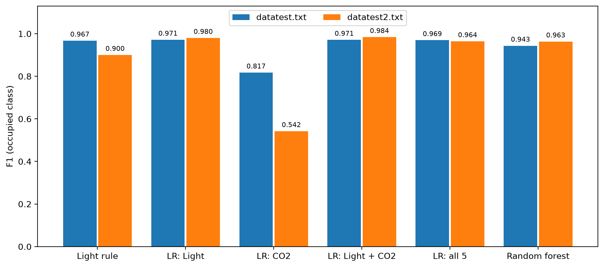
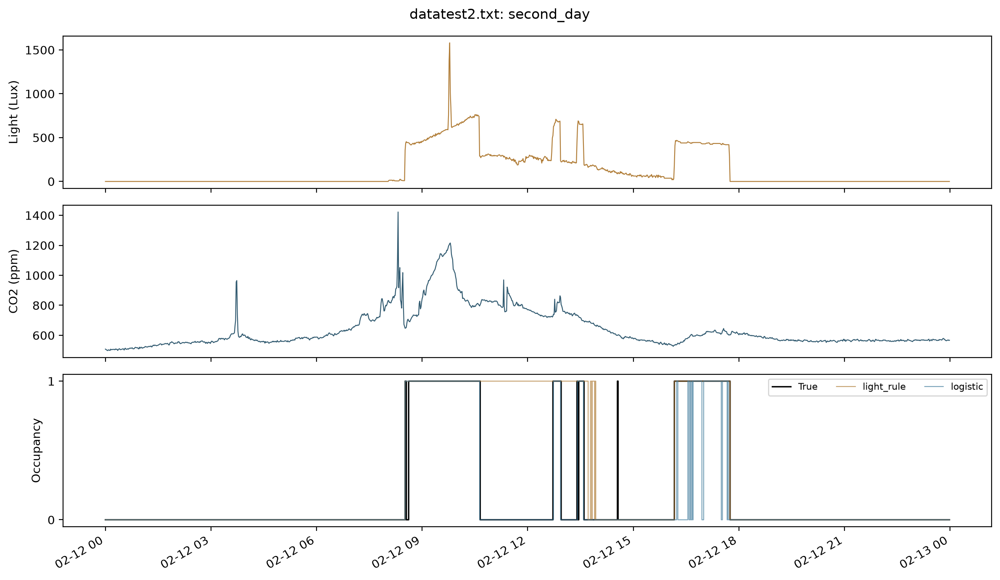
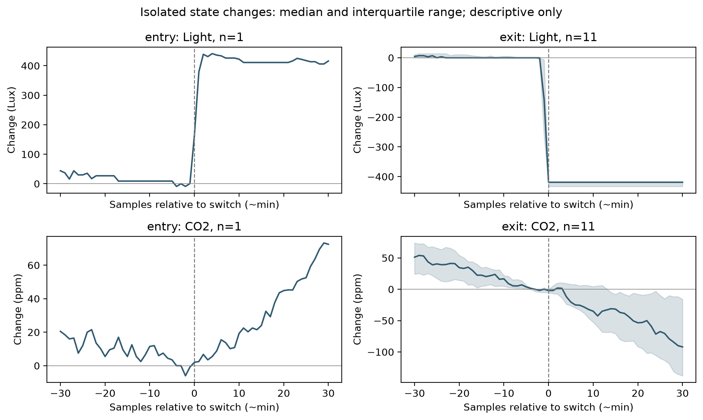

# 室内占用检测实验结果与分析

## 研究问题与主要发现

本项目使用当前时刻的环境观测判断单一房间是否有人。完整实验发现，光照是有效的识别信息，CO₂单独使用的跨时段稳定性较弱；光照与CO₂组合的逻辑回归在合并测试上获得约0.980的F1，但并非验证集选出的第一名。结果支持在本数据集内比较不同传感器信息的价值，不能证明增加传感器必然改善效果，也不能直接推广到其他房间。

## 数据与质量检查

训练文件8,143条，测试1为2,665条，测试2为9,752条，共20,560条观测。五个环境特征为温度、相对湿度、光照、CO₂及含湿量；Occupancy为二分类标签。

三个文件的特征均无空缺，时间戳无重复。观测间隔为59、60或61秒，可以近似视为分钟级采样。训练文件覆盖2015年2月4日17:51至2月10日09:33；测试1早于训练期，测试2晚于训练期，因此两者并非都在评价未来预测。

训练、测试1、测试2的有人比例分别约21.23%、36.47%、21.01%。类别不平衡使始终预测无人也能取得较高准确率，因此评价重点为有人类的Precision、Recall、F1和无人类误报率FPR。

完整训练文件中，无人和有人记录的光照中位数分别为0、454 Lux；CO₂中位数分别为446、944 ppm。但两类分布存在重叠，不能直接视为完全可分。测试2无人记录的CO₂中位数升至587.5 ppm，高于训练文件无人记录的446 ppm，说明固定的CO₂绝对浓度映射会面临分布变化。均值、标准差、分位数与极值按文件和标签保存在 `outputs/complete/feature_distributions.csv`。

仅用训练部分计算的湿度与含湿量相关系数约0.918，光照与CO₂约0.808。相关性可能造成信息冗余，但不足以单独证明全特征模型表现下降的原因。

## 方法与实验设置

训练文件按时间排序，前6,514条用于训练，后1,629条用于验证。测试文件保持官方划分，模型输入只取当前五个环境量或预定子集，不使用日期、编号、目标标签或未来观测。

光照规则为Light大于约177.038 Lux时判定有人。候选阈值来自训练部分的201个分位点去重结果，按验证F1选取；并列时取较低阈值。阈值固定后不依据测试结果更改。

逻辑回归在标准化后拟合，四组输入为仅光照、仅CO₂、光照与CO₂、全部五个特征。每组只比较C为0.1、1、10的候选配置，按验证F1选择，概率阈值固定为0.5。标准化与分类器均在选择配置后使用完整训练文件重新拟合。

随机森林使用全部五个特征，固定200棵树，比较最大深度5或无限、叶节点最小样本数1或5。验证选择深度5、最小叶样本数1。随机种子固定为42。

测试评价按两个文件分别报告，合并指标由全部预测重新计算，没有简单平均两个F1。Precision、Recall的零分母按0处理；分析分组没有负类时FPR无定义，在CSV中留空。软件版本见requirements.txt和实验JSON，耗时见实验记录。

第一轮测试成绩已经在后续对比前查看过。后续仍按课程要求进行固定特征组对比，没有利用测试成绩扩展搜索；但这些结果不应包装成一个重新保密的盲测，也没有依据测试集挑选并宣布唯一部署模型。

## 方法与特征比较

各方法测试1、测试2及合并F1如下，完整精确率、召回率、FPR与混淆矩阵计数见 `outputs/complete/metrics.csv`：

- 光照规则：0.9672、0.9001、0.9207。
- 仅光照逻辑回归：0.9714、0.9798、0.9771。
- 仅CO₂逻辑回归：0.8173、0.5420、0.6219。
- 光照与CO₂逻辑回归：0.9709、0.9838、0.9796。
- 全特征逻辑回归：0.9694、0.9643、0.9659。
- 全特征随机森林：0.9432、0.9631、0.9567。

组合并非在所有条件下都超过仅光照，测试1中仅光照略高。完整训练后，仅光照逻辑回归的0.5概率边界约为341.36 Lux，明显高于规则阈值177.04 Lux。两者虽使用相同传感器，决策边界却不同，因此不能把规则的误报简单归因于缺少其他传感器。验证窗口与测试窗口差异、阈值并列时的选择约定，都可能影响泛化。

光照与CO₂组合在验证集的F1约0.9583，低于规则约0.9941、仅光照逻辑回归约0.9924和随机森林约0.9941。它在合并测试上排第一是测试后描述性发现，并非先验选模成功的证据。

以组合模型为例，测试1的Precision为0.9463、Recall为0.9969、F1为0.9709、FPR为0.0325；TN=1,638、FP=55、FN=3、TP=969。测试2的Precision为0.9733、Recall为0.9946、F1为0.9838、FPR为0.0073；TN=7,647、FP=56、FN=11、TP=2,038。

合并后，组合模型Precision为0.9644、Recall为0.9954、F1为0.9796、FPR为0.0118；TN=9,285、FP=111、FN=14、TP=3,007。它在本实验中表现为召回率较高，仍有误报，适用与否取决于实际系统对两种错误的代价要求。

## 误判时段与连续变化

连续图固定展示两个测试文件全时段和各文件第二个日历日，没有按最好看的成绩选择片段。图中状态对照为真实值、光照规则和全特征逻辑回归，保留第一轮方法便于观察。

测试2中，光照规则在2015年2月12日10:38:59至12:42:00连续误报124条记录。这段无人记录的光照中位数为274.5 Lux，超过规则阈值，但低于仅光照逻辑回归的约341.36 Lux边界。记录说明“亮度超过规则阈值”不等于“当前有人”；数据没有灯具开关与日照来源标签，因此不能确认是未关灯、自然光或其他因素造成。

以组合模型为例，在测试1状态变化后10分钟内，190条观测出现43次误报、3次漏报，F1约0.8321；距上次变化超过10分钟的2,280条观测F1约0.9910。测试2对应335条观测有41次误报、5次漏报，F1约0.8838；超过10分钟的9,381条观测F1约0.9943。

上述分组只使用文件内已观察到的最近一次标签切换。文件开始到第一次切换前的记录无法确定状态已持续多久，单列为初始状态年龄未知，不强行归到稳定时段。分组仅用于事后解释，不作为预测特征。不同组的类别比例不相同，F1差异不宜完全归因于环境响应滞后。

## 环境响应与滞后证据边界

三个文件总共有57次0到1与57次1到0的状态切换。为了避免重叠变化，要求切换前后各30个采样点齐全、间隔不大于61秒且没有其他状态切换。最终只有1次进入与11次离开符合要求。事件按原始标签识别，没有重新标注或平滑标签以增加数量。

对每个事件，以切换前5个CO₂观测的中位数为基线。唯一进入事件在约5、15、30分钟后的CO₂差值为+8.83、+24.0、+72.5 ppm；11次离开事件的对应差值中位数为−20.5、−31.67、−92.0 ppm。曲线阴影为事件间四分位范围，不是统计置信区间。

这些有限事件显示，光照可能在切换附近快速变化，而CO₂往往逐步变化。离开前的CO₂曲线也已经出现下降，因此不能将整个下降趋势归因于离开动作。不同事件的通风、人数和外界条件均未控制，不能从曲线推导固定的响应时间或因果滞后。进入只有1个样本，更不能据此给出一般规律。图中未来观测仅用于事后描述，分类器未使用它们。

## 适用范围与后续工作

本项目实现的是当前时刻状态检测，而非提前预测。数据来自单一房间与有限日期，光照和占用的联系可能依赖房间照明习惯。关闭照明时有人、开灯但无人、外部CO₂背景变化与通风变化，都可能改变模型行为。

相邻分钟记录存在依赖，12,417条测试观测不能视为12,417次独立重复实验。本项目不提供基于独立同分布假设的显著性检验，也不以微小F1差异宣称普遍优越。若用于实际部署，应在新房间或新的连续时段开展独立验证，再根据误报与漏报成本确定方案。

## 提交与复现

完整实验执行 `run_complete_experiment.py`，独立核验执行 `validate_submission.py`，入口命令见README。最终格式文件为 `outputs/complete/occupancy_predictions.csv`，包含6个方法，每方法覆盖两个测试文件共12,417条记录，总计74,502条，不含表头。

核验逐条对照原始数据，检查标识唯一、标签及时间一致、分数有限且位于0到1，并从预测独立重算混淆矩阵和各文件、合并指标。结果见 `validation.json`。原始行索引与文件内数据行序号在第一步划分清单中均有保留。

数据引用：Candanedo, L. (2016). Occupancy Detection. UCI. DOI: 10.24432/C5X01N。原始数据许可为CC BY 4.0，详细署名见仓库许可说明。
